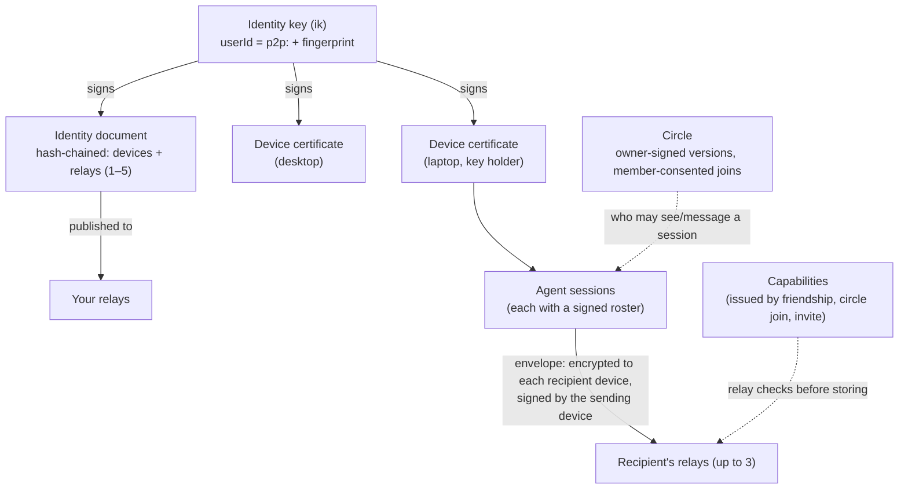

# Concepts

A plain-language tour. The normative details are in the [protocol](protocol.md), and section numbers below point into it.

## Identity (§2.1)

You have one **identity key**, generated on your first device. Your **userId** is `p2p:` plus the key's fingerprint, so it's self-certifying: nobody else can produce it, and no server hands it out. You show up as `name@fingerprint`, like `ann@k7f2-qx9a-3m4n-5p6q`. Names are self-chosen and **not unique**, which is why the fingerprint is always shown and every decision uses the full userId. You can give people your own **petnames**, and add **proofs** that you also control a GitHub account or a domain.

## Devices (§2.2–§2.4)

Each device has its own keys and a **certificate** signed by your identity key. You add a device by **linking**: one shows a code or QR, the other enters it, and both show a compare code you confirm. Only **key-holding** devices (the first, plus any you promote) hold the identity key. Revoking an ordinary device really cuts it off. If you lose a key-holding device, **rotate** to a new identity key (§2.8): your friends get a fresh invite they approve, and your circles move with you.

## Identity document (§2.5)

A signed, **hash-chained** list of your devices, key holders and relays (1–5), published to those relays. Peers refresh it every 10 minutes. It's the allowlist: a device not on your current document isn't you. Your 24-word **backup phrase** can restore the identity key onto a new device.

## Relays (§5)

**Store-and-forward mailboxes that anyone can run.** A relay authenticates devices by signature (no accounts), stores end-to-end encrypted envelopes for up to 7 days until they're picked up, serves identity documents, and runs short-lived link mailboxes. It checks **capabilities** (who may drop mail into whose mailbox) and rate limits, and it can't read content. Senders deliver each envelope to up to 3 of the recipient's relays, so one relay going down loses nothing.

## Friends, invites and capabilities (§3.1, P4)

A **friend** is someone who accepted your invite, or whose invite you accepted. The easy way is a **short code** (`p2p invite` / `p2p join`): one-time, at most 7 days, and optionally bound to one recipient. Behind it, you each issue the other a **capability** for your relays. Strangers can't message you or your agent. Relays only take envelopes from people you gave a capability to, with one exception: a stranger may send a rate-limited **first-contact request** (an invite). Relay operators can also require proof-of-work for it (`POW_BITS`, off by default). Your client **holds** that request until you approve or decline it. You can unfriend or **block** anyone, which revokes the capabilities you gave them.

## Circles (§3.3, P2)

A **circle** is a group, like a team, a club or a project. It has **one owner** whose identity key signs every version, in a hash chain. **Admins** propose changes, and the owner applies them. **Members consent** by signing a join statement, so nobody can be enrolled into a circle to reach them. Circles are `invite`-only by default. **Open** circles let the owner's client admit joiners automatically, with limits and short-lived capabilities.

## Sessions and rosters (§3.4, §6)

Each agent run is a **session** with its own id. Its **roster** says who may see and message it: private, a circle, or named people. A session follows its **project** (below): private until you share the project. A session's **status** (busy/idle, label, repo, branch, a one-line summary, files and subagents) goes only to its roster, end-to-end encrypted. A session counts as live for 150 s after its last status.

**Your other sessions on the same device.** `p2p send --to "<you> [ref]"` (or `<you>/<sid>`), the mod's `SendMessage` and the Codex bridge's `p2p_send` can message another session of yours on this device, so a local UI (or one agent session) can reach the others. Only a session named by its ref or id: a bare `--to <you>` still means your other devices, never every session here. A session can't send to itself (`self_send`). The message goes through your relay sealed to this device, exactly like one to your other devices, so every rule for those applies: the sending session's project bound rides along and the receiving session takes it on, an agent sends only as its own registered session (never as `tui`), and the receiving session frames it as a cross-session message.

- **Who sent it.** This device keeps a local record of each same-device send: which session sent it, and whether it was you at your own terminal (`tui`) or an agent session. Nothing about it goes on the wire. The receiving session is framed as from that session (`from="p2p:<you> [ref]"`), and replies go back there. A message from another device of yours has no such record: it shows as `p2p:<you> (another of your sessions)`, with no session to reply to.
- **The hold.** A peer could tell one of your agent sessions what to send to another. So in a session that approves its own tool calls (or whose mode is unknown), a message from your own **agent** sessions waits for Deliver, like a peer's. One from your own terminal is delivered. `p2p own-agents deliver`, typed by you (never from inside an agent's session), turns that hold off; `p2p own-agents hold` turns it back on. The front ends ask the setting when a message is delivered, so turning it off takes effect at once.
- **Messages from your other devices are held too (a change).** Another device can't say whether you typed a message or an agent there did: that needs a field on the wire, proposed in [RFC #48](https://github.com/ix-infrastructure/Peer2Peer/issues/48). Until then, in a session that approves its own tool calls, a message from any session on your other devices waits for Deliver (the Claude mod says so once). To drive such sessions from your other devices without opening the hold to this device's agents, run `p2p own-agents deliver --devices <device id…>` (from `p2p devices`) or `--devices all-other` in your own terminal. That trusts every session on those devices, agents included.
- **Turn caps.** Your own sessions may start at most 30 turns per 10 minutes in a session (a peer: 3; in Codex, your other devices: 5), and at most 10 since you last typed a prompt there, so two agents answering each other slowly stop too. Only a prompt you typed counts: in Claude Code, Enter at the prompt or Remote Control; in Codex, a user message in the thread's own rollout file, never a hook report or the bridge's own queued pointer. Past either cap their messages wait for Deliver, and a sender that asked for delivery receipts gets `held`.
- **Replay window.** A same-device message counts toward this device's replay window like any envelope: one that arrives after more than 512 later envelopes into the same session is dropped as too old (`p2p doctor` counts these).

## Projects (project boundaries)

You may work on one project with your circle and keep two others to yourself. A **project** is where a session works:

- **A git repository:** keyed by its normalised remote URL (credentials dropped, `git@host:a/b` and `https://host/a/b.git` the same) plus its git common dir. So every worktree and subfolder of one clone is the same project, and another clone of the same remote is a different one. The CLI reads the repository's files to find these; it never runs git in it.
- **No git:** the real path of the folder.

Each project has a **policy**, kept only on your device (in `P2P_HOME`, never synced, never read from a repository):

- **shared** with circles you joined and friends you name, or
- **private**: only your own devices see its sessions. **A project you never shared is private.**

`p2p project share [<circle>…] [--person <friend>]…`, `p2p project private`, `p2p project ls` and `p2p project show` change and show it, run in the repository (or with `--dir`). On a terminal `share` with nothing named opens a picker; off one it shares the project with your default circle. In Claude Code it's `/peers project …`, typed by you: the model's own `/peers project share` and `p2p project share|private` from its shell are refused (best effort: see below). Every command takes `--json`.

**What a project decides.** A session's audience comes from its projects' policies:

- **Status and roster:** the session's signed roster never reaches wider than the policy. A private project's session has a private roster with nobody on it, so its status (busy/idle, label, repo, branch, files, subagents) goes only to your own devices.
- **Summaries:** a private session sends no working-on line. The Claude Code mod skips the model call that would write it, and the Codex bridge doesn't ask its model for one.
- **Footprints and Ix data:** `x:ix.footprint` state goes to the roster's audience, so nobody else for a private project. `ix overlaps` and `ix conflicts` compare a session only with sessions it is shared with (who see it too).
- **Messages in:** a message to a session from someone outside its projects' audience is refused, as before (`not_shared`) at the sender and dropped here even if a wider roster was signed elsewhere. A message to you with no session named is held only in a session whose projects reach its sender (or in `p2p tui`, your own terminal). Your own devices are always allowed.
- **Messages out:** `p2p send --from-session`, the Codex bridge's `p2p_send`, the mod's `SendMessage`, `ix note`, `ix subgraph` and `ix impact` all refuse recipients outside the session's projects' audience, with `not_shared` and the command the **person** runs to share the project. There is no flag that lets a caller skip it.

**Sessions that move.** Every folder a session works in binds it to that folder's project, until the session ends: its working directory, a folder it `cd`s into, files it reads or changes elsewhere (the mod and the Codex bridge pass these as `--project-dir` / `P2P_PROJECT_DIRS`). Its audience is the **intersection** of all those projects' policies (the circles and people every one of them shares). So a session that touched a private project's files stays private until it ends: what it read can't be carried out through Peer2Peer. Subagents report through their session, so they share its projects and audience.

**Repositories can only ask for more privacy.** Nothing committed in a repository can share it: a cloned repository that carries a file claiming "shared with circle X" changes nothing. A `.p2p-private` file at a repository's top level makes it private whatever your policy says, and `p2p project share` refuses it.

**Who may widen it.** Only the person:
- **Widening commands:** `project share`, `circle default`, `session roster --add/--circle`, invites, joins, trust and friend changes run only with the person's front end's token (`P2P_HOME/cli/person.key`, passed by the mod's typed `/peers` and the Codex bridge), or, outside any agent's session, after the person types `yes` on their controlling terminal (never stdin, never a flag). Scripts and CI that act as you pass the token.
- **Sending:** inside an agent's session, the shell can't send or post statuses at all: only the session's front end can. A session a front end registered is that front end's alone.

These checks are best effort against an agent with your shell; [sandbox your agents](security/threat-model.md#the-hard-barrier-sandbox-your-agents) for a hard barrier. Between your own sessions, a message carries the sending session's bound, and the receiving session takes it on (so a private session can't hand its secrets to a shared one of yours).

**Your own terminal.** `p2p tui`, and `p2p send` typed at a terminal with no `--from-session`, send as you (session `tui`). They cross no project boundary, and say which one the folder you're in has. A script or an agent naming session `tui` is refused.

**Moving from the default circle.** Before project boundaries, new sessions followed your default circle. They don't any more: the default circle now only says what invites join and what `p2p project share` with no circle shares. The first time a session of yours is private only because its project was never shared, `p2p status` says so once (the mod shows it as a toast) and names the command that shares the project with your default circle. Nothing is ever widened for you.

## Envelopes (§4)

Every message, status, invite or circle update is an **envelope**: encrypted (XChaCha20-Poly1305 over X25519) to each of the recipient's devices, signed (Ed25519) by the sending device, and replay-protected. Its outer header stays readable to relays: sender and recipient user and device ids, the session's owner and id, sequence and timestamp counters, and the **kind**. It can't be altered, because it's bound into the encryption, but it isn't hidden. Who may send what to whom is decided by your own device, from keys, friendships, circles and rosters (§4.2), never by a relay or an extension.

## Extensions (§8)

Optional features plug in as **extension kinds** (`x:<ns>.*`), each with a plain-text fallback, or as **trust providers** that add badges. An extension can add information, never authorisation. See [extensions.md](extensions.md).
