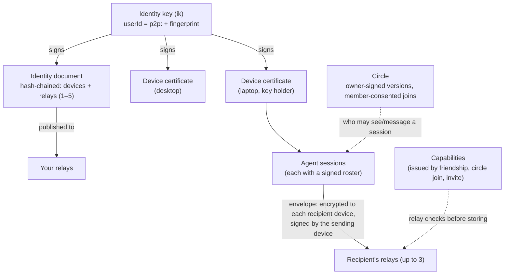

# Concepts

A plain-language tour. The normative details are in the [protocol](protocol.md), and section numbers below point into it.

## Identity (§2.1)

You have one **identity key**, generated on your first device. Your **userId** is `p2p:` plus the key's fingerprint, so it's self-certifying: nobody else can produce it, and no server hands it out. You show up as `name@fingerprint`, like `ann@k7f2-qx9a-3m4n-5p6q`. Names are self-chosen and **not unique**, which is why the fingerprint is always shown and every decision uses the full userId. You can give people your own **petnames**, and add **proofs** that you also control a GitHub account or a domain.

## Devices (§2.2–§2.4)

Each device has its own keys and a **certificate** signed by your identity key. You add a device by **linking**: one shows a code or QR, the other enters it, and both show a compare code you confirm. Only **key-holding** devices (the first, plus any you promote) hold the identity key. Revoking an ordinary device really cuts it off. If you lose a key-holding device, **rotate** to a new identity key (§2.8): your friends get a fresh invite they approve, and your circles move with you.

## Identity document (§2.5)

A signed, **hash-chained** list of your devices, key holders and relays (1–5), published to those relays. Peers refresh it every 10 minutes. It's the allowlist: a device not on your current document isn't you. Your 24-word **backup phrase** can restore the identity key onto a new device.

## Relays (§5)

**Store-and-forward mailboxes that anyone can run.** A relay authenticates devices by signature (no accounts), stores end-to-end encrypted envelopes for up to 7 days until they're picked up, serves identity documents, and runs short-lived link mailboxes. It checks **capabilities** (who may drop mail into whose mailbox) and rate limits, and it can't read content. Senders deliver each envelope to up to 3 of the recipient's relays, so one relay going down loses nothing.

## Friends, invites and capabilities (§3.1, P4)

A **friend** is someone who accepted your invite, or whose invite you accepted. The easy way is a **short code** (`p2p invite` / `p2p join`): one-time, at most 7 days, and optionally bound to one recipient. Behind it, you each issue the other a **capability** for your relays. Strangers can't message you or your agent. Relays only take envelopes from people you gave a capability to, with one exception: a stranger may send a rate-limited **first-contact request** (an invite). Relay operators can also require proof-of-work for it (`POW_BITS`, off by default). Your client **holds** that request until you approve or decline it. You can unfriend or **block** anyone, which revokes the capabilities you gave them.

## Circles (§3.3, P2)

A **circle** is a group, like a team, a club or a project. It has **one owner** whose identity key signs every version, in a hash chain. **Admins** propose changes, and the owner applies them. **Members consent** by signing a join statement, so nobody can be enrolled into a circle to reach them. Circles are `invite`-only by default. **Open** circles let the owner's client admit joiners automatically, with limits and short-lived capabilities.

## Sessions and rosters (§3.4, §6)

Each agent run is a **session** with its own id. Its **roster** says who may see and message it: private, a circle, or named people. A session follows its **project** (below): private until you share the project. A session's **status** (busy/idle, label, repo, branch, a one-line summary, files and subagents) goes only to its roster, end-to-end encrypted. A session counts as live for 150 s after its last status.

**Your other sessions on the same device.** `p2p send --to "<you> [ref]"` (or `<you>/<sid>`), the mod's `SendMessage` and the Codex bridge's `p2p_send` can message another session of yours on this device, so a local UI (or one agent session) can reach the others. Only a session named by its ref or id: a bare `--to <you>` still means your other devices, never every session here. A session can't send to itself (`self_send`). The message goes through your relay sealed to this device, exactly like one to your other devices, so every rule for those applies: the sending session's project bound rides along and the receiving session takes it on, an agent sends only as its own registered session (never as `tui`), and the receiving session frames it as a cross-session message.

- **Who sent it.** This device keeps a local record of each same-device send: which session sent it, and whether it was you at your own terminal (`tui`) or an agent session. Nothing about it goes on the wire. The receiving session is framed as from that session (`from="p2p:<you> [ref]"`), and replies go back there. A message from another device of yours has no such record: it shows as `p2p:<you> (another of your sessions)`, with no session to reply to.
- **The hold.** A peer could tell one of your agent sessions what to send to another. So in a session that approves its own tool calls (or whose mode is unknown), a message from your own **agent** sessions waits for Deliver, like a peer's. One from your own terminal is delivered. `p2p own-agents deliver`, typed by you (never from inside an agent's session), turns that hold off; `p2p own-agents hold` turns it back on. The front ends ask the setting when a message is delivered, so turning it off takes effect at once.
- **Messages from your other devices are held too (a change).** Another device can't say whether you typed a message or an agent there did: that needs a field on the wire, proposed in [RFC #48](https://github.com/ix-infrastructure/Peer2Peer/issues/48). Until then, in a session that approves its own tool calls, a message from any session on your other devices waits for Deliver (the Claude mod says so once). To drive such sessions from your other devices without opening the hold to this device's agents, run `p2p own-agents deliver --devices <device id…>` (from `p2p devices`) or `--devices all-other` in your own terminal. That trusts every session on those devices, agents included.
- **Turn caps.** Your own sessions may start at most 30 turns per 10 minutes in a session (a peer: 3; in Codex, your other devices: 5), and at most 10 since you last typed a prompt there, so two agents answering each other slowly stop too. Only a prompt you typed counts: in Claude Code, Enter at the prompt or Remote Control; in Codex, a user message in the thread's own rollout file, never a hook report or the bridge's own queued pointer. Past either cap their messages wait for Deliver, and a sender that asked for delivery receipts gets `held`.
- **Replay window.** A same-device message counts toward this device's replay window like any envelope: one that arrives after more than 512 later envelopes into the same session is dropped as too old (`p2p doctor` counts these).

## Projects (project boundaries)

You may work on one project with your circle and keep two others to yourself. A **project** is where a session works:

- **A git repository:** keyed by its normalised remote URL (credentials dropped, `git@host:a/b` and `https://host/a/b.git` the same) plus its git common dir. So every worktree and subfolder of one clone is the same project, and another clone of the same remote is a different one. The CLI reads the repository's files to find these; it never runs git in it.
- **No git:** a folder, by its real path. A share is for that folder alone, unless you ask for its subfolders too (`p2p project share --subfolders`, or `/peers project share --subfolders`): with `~/src` shared that way, a session in `~/src/tmp` is in `~/src`'s project. Shares made before `--subfolders` existed stay for their folder alone. Covering is refused for `/`, your home folder and the folders that hold home folders (`/Users`, `/home`, `/home/<user>`), the temporary folders (`/tmp`, `/private/tmp`, `/var/folders/…`, the system's temp folder) and the system's top folders; sharing one of those for itself alone is still allowed. With `--subfolders`, the CLI warns about the git repositories and `.p2p-private` folders it finds below (it looks 4 levels and 2,000 entries deep, and says when it stopped early).

  The nearest folder at or above with a policy of its own decides. It is the project when it is the session's own folder or its share covers subfolders; otherwise the session's own folder is, so a subfolder you made private stays private. The walk never crosses a git repository (always its own project; a bare repository, or a folder with a `.git` file, too), a `.p2p-private` (at a folder or above it: private, whatever covers it), a folder whose `.git` the path itself names (a command that may have just removed it), or a folder that is gone: a path that doesn't exist (deleted or moved since the session named it, or not made yet) is its nearest existing folder's, never one above that, unless that folder has a policy of its own. The front ends also bind the `.git` (or `.p2p-private`) of the repository each path is in, so a repository removed after a session read it is never covered from above. A policy a covered subfolder gets later still narrows the sessions that worked in it. Device files (`/dev/null`) are no project.

Each project has a **policy**, kept only on your device (in `P2P_HOME`, never synced, never read from a repository):

- **shared** with circles you joined and friends you name, or
- **private**: only your own devices see its sessions. **A project you never shared is private.**

`p2p project share [<circle>…] [--person <friend>]…`, `p2p project private`, `p2p project ls` and `p2p project show` change and show it, run in the repository (or with `--dir`). On a terminal `share` with nothing named opens a picker; off one it shares the project with your default circle. In Claude Code it's `/peers project …`, typed by you: the model's own `/peers project share` and `p2p project share|private` from its shell are refused (best effort: see below). Every command takes `--json`.

**What a project decides.** A session's audience comes from its projects' policies:

- **Status and roster:** the session's signed roster never reaches wider than the policy. A private project's session has a private roster with nobody on it, so its status (busy/idle, label, repo, branch, files, subagents) goes only to your own devices.
- **Summaries:** a private session sends no working-on line. The Claude Code mod skips the model call that would write it, and the Codex bridge doesn't ask its model for one.
- **Footprints and Ix data:** `x:ix.footprint` state goes to the roster's audience, so nobody else for a private project. `ix overlaps` and `ix conflicts` compare a session only with sessions it is shared with (who see it too).
- **Messages in:** a message to a session from someone outside its projects' audience is refused, as before (`not_shared`) at the sender and dropped here even if a wider roster was signed elsewhere. A message to you with no session named is held only in a session whose projects reach its sender (or in `p2p tui`, your own terminal). Your own devices are always allowed.
- **Messages out:** `p2p send --from-session`, the Codex bridge's `p2p_send`, the mod's `SendMessage`, `ix note`, `ix subgraph` and `ix impact` all refuse recipients outside the session's projects' audience, with `not_shared` and the command the **person** runs to share the project. There is no flag that lets a caller skip it.

**Sessions that move.** Every folder a session works in binds it to that folder's project, until the session ends: its working directory, a folder it `cd`s into, files it reads or changes elsewhere (the mod and the Codex bridge pass these as `--project-dir` / `P2P_PROJECT_DIRS`). Its audience is the **intersection** of all those projects' policies (the circles and people every one of them shares). So a session that touched a private project's files stays private until it ends: what it read can't be carried out through Peer2Peer. Subagents report through their session, so they share its projects and audience.

A session keeps up to 64 projects. That limit only bounds what is stored: more projects can only narrow the intersection, so a higher limit never lets a session reach anyone a lower one wouldn't. Past it the session is private.

**A session's own scratch is the session, not a project.** Claude Code keeps folders for each session: the output of its background tasks (`<tmp>/claude-<uid>/<project>/<session id>/`), the large tool results and subagent transcripts it saves (`~/.claude/projects/<project>/<session id>/`), and a background job's folder (`$CLAUDE_JOB_DIR`, `~/.claude/jobs/<id>/`). What is in them came from the session's own tool calls, whose own paths already bound it, so the Claude Code mod names them to the CLI and a path in them binds no project. That is checked strictly:
- only this session's folders, by its exact id: another session's folder, the `memory` folder and transcripts that sessions of a project share, or a name that only looks like it (`<id>-x`), bind as any folder does;
- on real paths: a symlink in the scratch binds what it points at, and a path written with a `..` never gets the exemption (it binds where the file system takes it: `link/../x` is beside the link's target);
- a git repository or a `.p2p-private` in the scratch is still its own project (a private repository cloned there stays private), and so is a folder you gave a policy, a folder with a `.git` that can't be read, or a path that names a `.git`;
- the job folder counts only when its name is the start of the session's id (so after a `/clear`, a new id, it binds again), and each folder must be yours and not a symlink;
- only the mod's own `p2p` runs (with your person token) can name them;
- it fails closed: a scratch folder that can't be read, or that holds more than 4,096 entries (its symlinks can't all be checked), isn't skipped, so paths in it bind as anywhere else (usually making the session private). It is off on Windows for now.

**Why a session is private, and what helps.** A refusal says its cause, and `p2p session show <sid>` (in your own terminal; `/peers session` in Claude Code) lists a session's projects, who each is shared with, and every reason:
- a project never shared, or made private: sharing it helps (`p2p project share`);
- more than 64 projects, more folders than Peer2Peer keeps track of, a path its front end couldn't resolve (one starting with a variable or `$(…)` it doesn't know, like `$X/y`), a front end that lost track (a forked conversation), a `.p2p-private`, or a private session's message: these last until the session ends, so sharing can't help. Start a new session for the work you want to share.

An agent's shell can't run `session show` (it would read other sessions' bindings).

**Repositories can only ask for more privacy.** Nothing committed in a repository can share it: a cloned repository that carries a file claiming "shared with circle X" changes nothing. A `.p2p-private` file at a repository's top level makes it private whatever your policy says, and `p2p project share` refuses it.

**Who may widen it.** Only the person:
- **Widening commands:** `project share`, `circle default`, `session roster --add/--circle`, invites, joins, trust and friend changes run only with the person's front end's token (`P2P_HOME/cli/person.key`, passed by the mod's typed `/peers` and the Codex bridge), or, outside any agent's session, after the person types `yes` on their controlling terminal (never stdin, never a flag). Scripts and CI that act as you pass the token.
- **Sending:** inside an agent's session, the shell can't send or post statuses at all: only the session's front end can. A session a front end registered is that front end's alone.

These checks are best effort against an agent with your shell; [sandbox your agents](security/threat-model.md#the-hard-barrier-sandbox-your-agents) for a hard barrier. Between your own sessions, a message carries the sending session's bound, and the receiving session takes it on (so a private session can't hand its secrets to a shared one of yours).

**Your own terminal.** `p2p tui`, and `p2p send` typed at a terminal with no `--from-session`, send as you (session `tui`). They cross no project boundary, and say which one the folder you're in has. A script or an agent naming session `tui` is refused.

**Moving from the default circle.** Before project boundaries, new sessions followed your default circle. They don't any more: the default circle now only says what invites join and what `p2p project share` with no circle shares. The first time a session of yours is private only because its project was never shared, `p2p status` says so once (the mod shows it as a toast) and names the command that shares the project with your default circle. Nothing is ever widened for you.

**Graph targets.** Each project also has a graph target: where Ix calls made for it may go. Today it is always `local`, this machine's Ix backend ("local only" in `p2p project show` and `p2p doctor`). A session's target is the intersection of its projects', like its ceiling, so one private project keeps it local. Shared graphs (a circle's graph in the cloud) come later, and only a project shared with that circle will reach one. See the [threat model](security/threat-model.md#graph-targets-ix).

**Graph memory.** With the Ix extension on and an Ix that has the open-source `ix note` (Ix after 0.13.0, without Ix Pro), your sessions in **shared** projects have their context written into your **local** Ix graph as they run. A session in a private project is never recorded.
- **What it writes.** Each session gets an Ix session record named `p2p-<session id>`, with its label, repository and branch. Its notes are tagged `finding` and start with "Recorded by Peer2Peer (agent-generated, untrusted)", one each for:
  - its start;
  - each new status line;
  - the files it edits (repo-relative, as its status lists them);
  - its end.
- **What it never writes.** Message bodies (message history stays in its own encrypted store), peers' statuses and other devices' sessions. A note a peer shares goes in only when you import it with `p2p ix import`, as before.
- **How it runs.** `p2p watch` does the writing in the background, from the statuses your session already posted, so the hook path never waits on Ix. The writes are best effort: at most 64 items wait in the queue, and `p2p doctor` counts anything dropped.
- **Local only.** Every batch goes through the graph-target chokepoint and must be `local`. A shared target is refused. With Ix Pro installed, whose `ix note` writes to your cloud org, nothing is written at all. With an older Ix, the doctor says to upgrade.
- **Only to your own backend.** Before writing, ext-ix checks that the local endpoint's port is held by your own process. Root's process counts only if you set `"ixTrustRootListener": true` in config.json by hand (Docker's port proxy on Linux runs as root; set it only if that Docker is yours alone). If another user's process holds it, or the check can't tell, memory stays off and the doctor says why. On a machine other people log in to, turn it off.
- **Records stay with their session.** `p2p ix note --ix-note` won't send another session's record unless that session's context may go where this one's does.
- **Turning it off.** Set `"ixMemory": false` in config.json, or `P2P_IX_MEMORY=0`.

## Message history

Messages to you (in `p2p tui`, or with no session named) and to your agent sessions only show live, so each device also keeps a **message history**: what it sent and received, to look back at with `p2p history` (the TUI's Messages screen, `/peers history` in Claude Code, `p2p_history` in Codex).

- **Local only.** It lives in `P2P_HOME` on each device and is never synced, sent to a relay or shared with a peer. Nothing on the wire changes.
- **Encrypted at rest.** Sealed (ChaCha20-Poly1305) under a key of its own, `P2P_HOME/cli/history.key` (0600), with each file's name bound in, so no message text sits in the history files. There's no OS keychain backend yet, so the key sits next to your device keys: it keeps the text out of backups, indexers and a grep of the folder, not away from malware running as you.
- **Bounded.** 30 days by default and at most 8 MiB, pruned on every write: `"history": {"retentionDays": 30, "maxBytes": 8388608}` in `config.json`. Past the cap the oldest go first, whoever sent them, so a friend who sends a lot pushes older messages out sooner. `"enabled": false` (or `P2P_HISTORY=0`) keeps nothing new. `p2p history --clear` deletes it all, key included, and the messages still in the event log `p2p watch` reads (a message a session hasn't shown yet goes too).
- **What it keeps.** Message text in and out, once each, and extension kinds as their one-line fallback (never the body). Not statuses, rosters or control events. Each record's time is when it arrived on this device (the sender's own time is kept beside it), so a sender can't backdate a message past retention.
- **Crashes and damaged files.** Every write is copy-on-write: a new version goes under a fresh file name, then the index (and its copy), then the old version is removed, so a crash at any point loses at most what was being written. Reads take the same lock as writes. The index names each segment with its hash and the next unused number: an older segment put back (a pruned one, or a version that was replaced) is never taken back in. A file that can't be opened (altered, sealed under a key that was replaced) is never shown; at the next write it is set aside as `history.bad-<time>-<name>.json` and said on stderr, not deleted silently. If neither the index nor its copy opens, no segment is trusted and all are set aside. Set-aside files go once past retention.

**Who reads what.**

- **Your inbox, and everything** (`p2p history`, `--inbox`, `p2p tui`): only you, by the same gate as the other person-only commands: your front end's token, or your `yes` typed on your own terminal. It is refused inside an agent's session. In Claude Code, `/peers history` typed at your own terminal (not over Remote Control) shows it **above the prompt, to you only**: the command's result, which Claude reads and the transcript keeps, says only how many there are.
- **A session's own** (`--session <sid>`): its front end reads it for it, for a session a front end registered, and only what the session recorded since its binding began, in projects it is still bound to. A record whose session had no project binding when it was kept is yours only. A session never reads your inbox, another session's history or another project's, and a session id that comes back with a new binding sees nothing from before. The Codex bridge's `p2p_history` shows a received message's text only if that session showed it to its model, or you released it, in this run, from your own sessions too (an agent session of yours or another device is held like a peer); anything else (held, declined, expired, from before a restart) is listed by sender only. Claude Code has no such tool: what a session received is already in its conversation.

Message text is still the sender's data: framed as theirs when a model reads it, and stripped of control characters for a terminal.

## Envelopes (§4)

Every message, status, invite or circle update is an **envelope**: encrypted (XChaCha20-Poly1305 over X25519) to each of the recipient's devices, signed (Ed25519) by the sending device, and replay-protected. Its outer header stays readable to relays: sender and recipient user and device ids, the session's owner and id, sequence and timestamp counters, and the **kind**. It can't be altered, because it's bound into the encryption, but it isn't hidden. Who may send what to whom is decided by your own device, from keys, friendships, circles and rosters (§4.2), never by a relay or an extension.

## Extensions (§8)

Optional features plug in as **extension kinds** (`x:<ns>.*`), each with a plain-text fallback, or as **trust providers** that add badges. An extension can add information, never authorisation. See [extensions.md](extensions.md).
