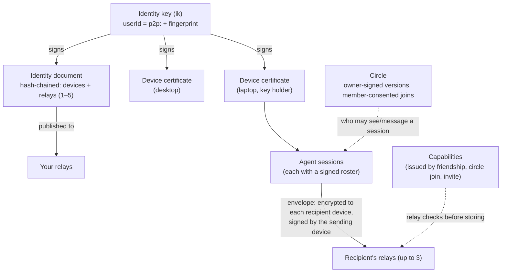

# Concepts

A plain-language tour. The normative details are in the [protocol](protocol.md), and section numbers below point into it.

## Identity (§2.1)

You have one **identity key**, generated on your first device. Your **userId** is `p2p:` plus the key's fingerprint, so it's self-certifying: nobody else can produce it, and no server hands it out. You show up as `name@fingerprint`, like `ann@k7f2-qx9a-3m4n-5p6q`. Names are self-chosen and **not unique**, which is why the fingerprint is always shown and every decision uses the full userId. You can give people your own **petnames**, and add **proofs** that you also control a GitHub account or a domain.

## Devices (§2.2–§2.4)

Each device has its own keys and a **certificate** signed by your identity key. You add a device by **linking**: one shows a code or QR, the other enters it, and both show a compare code you confirm. Only **key-holding** devices (the first, plus any you promote) hold the identity key. Revoking an ordinary device really cuts it off. If you lose a key-holding device, **rotate** to a new identity key (§2.8): your friends get a fresh invite they approve, and your circles move with you.

## Identity document (§2.5)

A signed, **hash-chained** list of your devices, key holders and relays (1–5), published to those relays. Peers refresh it every 10 minutes. It's the allowlist: a device not on your current document isn't you. Your 24-word **backup phrase** can restore the identity key onto a new device.

## Relays (§5)

**Store-and-forward mailboxes that anyone can run.** A relay authenticates devices by signature (no accounts), stores end-to-end encrypted envelopes for up to 7 days until they're picked up, serves identity documents, and runs short-lived link mailboxes. It checks **capabilities** (who may drop mail into whose mailbox) and rate limits, and it can't read content. Senders deliver each envelope to up to 3 of the recipient's relays, so one relay going down loses nothing.

## Friends, invites and capabilities (§3.1, P4)

A **friend** is someone who accepted your invite, or whose invite you accepted. The easy way is a **short code** (`p2p invite` / `p2p join`): one-time, at most 7 days, and optionally bound to one recipient. Behind it, you each issue the other a **capability** for your relays. Strangers can't message you or your agent. Relays only take envelopes from people you gave a capability to, with one exception: a stranger may send a rate-limited **first-contact request** (an invite). Relay operators can also require proof-of-work for it (`POW_BITS`, off by default). Your client **holds** that request until you approve or decline it. You can unfriend or **block** anyone, which revokes the capabilities you gave them.

## Circles (§3.3, P2)

A **circle** is a group, like a team, a club or a project. It has **one owner** whose identity key signs every version, in a hash chain. **Admins** propose changes, and the owner applies them. **Members consent** by signing a join statement, so nobody can be enrolled into a circle to reach them. Circles are `invite`-only by default. **Open** circles let the owner's client admit joiners automatically, with limits and short-lived capabilities.

## Sessions and rosters (§3.4, §6)

Each agent run is a **session** with its own id. Its **roster** says who may see and message it: private, a circle, or named people. New sessions follow your **default circle**. A session's **status** (busy/idle, label, repo, branch, a one-line summary, files and subagents) goes only to its roster, end-to-end encrypted. A session counts as live for 150 s after its last status.

## Envelopes (§4)

Every message, status, invite or circle update is an **envelope**: encrypted (XChaCha20-Poly1305 over X25519) to each of the recipient's devices, signed (Ed25519) by the sending device, and replay-protected. Its outer header stays readable to relays: sender and recipient user and device ids, the session's owner and id, sequence and timestamp counters, and the **kind**. It can't be altered, because it's bound into the encryption, but it isn't hidden. Who may send what to whom is decided by your own device, from keys, friendships, circles and rosters (§4.2), never by a relay or an extension.

## Extensions (§8)

Optional features plug in as **extension kinds** (`x:<ns>.*`), each with a plain-text fallback, or as **trust providers** that add badges. An extension can add information, never authorisation. See [extensions.md](extensions.md).
